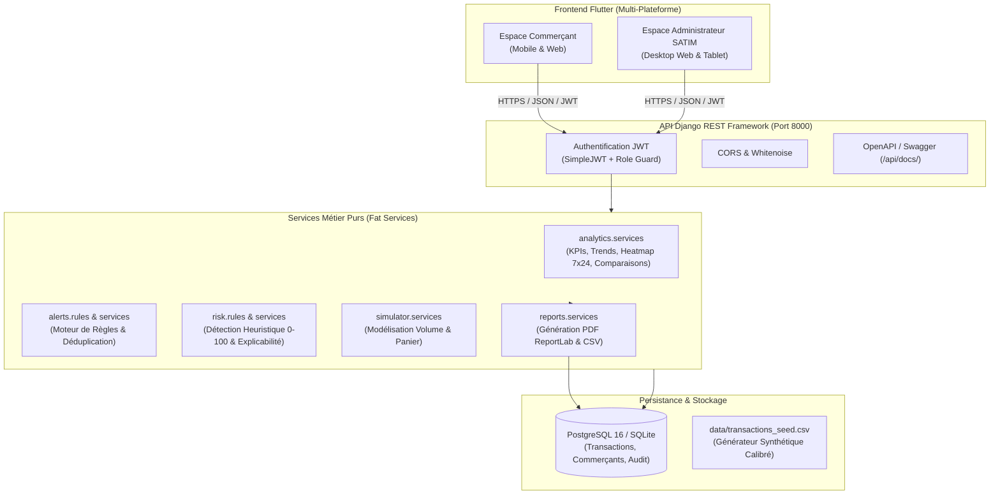
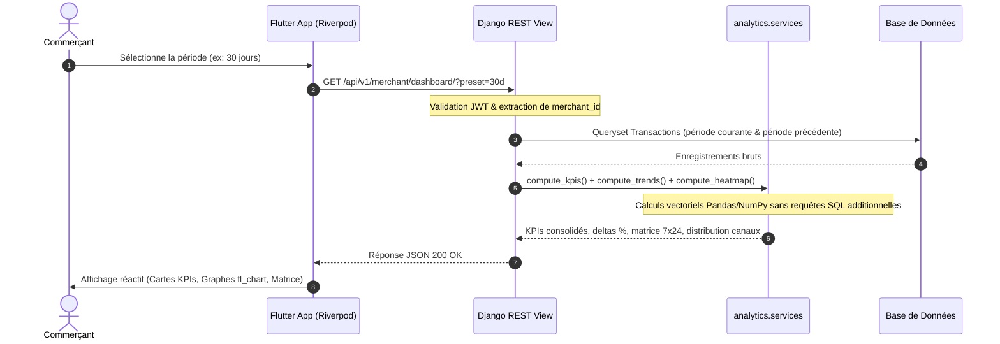
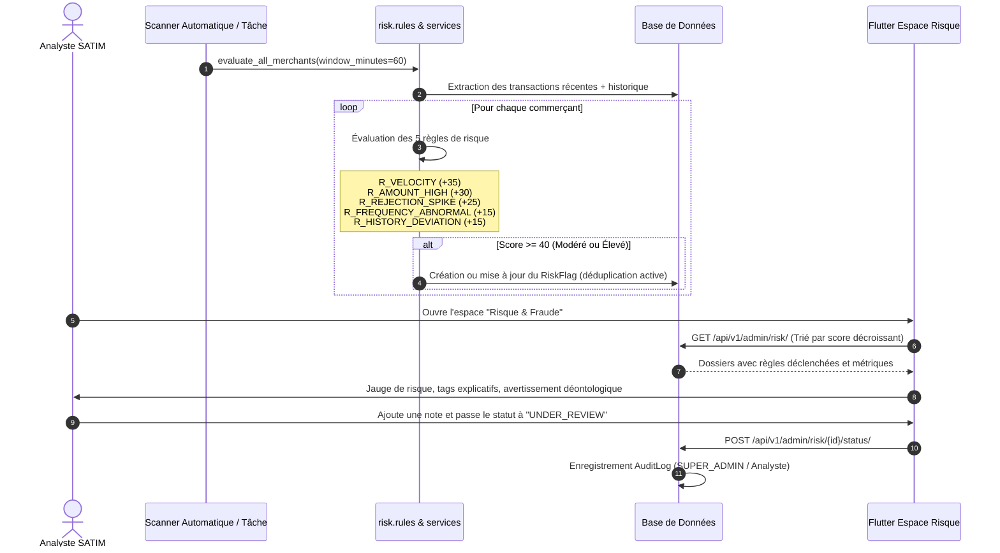

# Architecture du Système • MERCHANT PAY

Ce document décrit l'architecture technique, les flux de données et les choix de conception du projet **MERCHANT PAY**, développé dans le cadre du hackathon FINOVIA × ENSM × SATIM.

---

## 1. Vue d'Ensemble & Composants

MERCHANT PAY est une couche d'intelligence commerçante construite sur les flux d'encaissement des cartes interbancaires algériennes (**CIB**) et de la carte monétique d'Algérie Poste (**EDAHABIA**). 

Le système est découplé en deux tiers principaux :
1. **Frontend Universel (Flutter Mobile + Web Responsive) :** Une base de code Dart unique offrant deux espaces distincts et étanches (Espace Commerçant & Espace Administrateur SATIM).
2. **Backend d'Intelligence (Django 5 REST Framework + Pandas + NumPy) :** Une API REST haute performance avec architecture "Thin Views, Fat Services", isolant 100% de la logique métier dans des modules de services purs.

---

## 2. Diagramme de Séquence • Consultation du Tableau de Bord Commerçant

Lorsqu'un commerçant se connecte et consulte ses encaissements :

---

## 3. Diagramme de Séquence • Moteur de Détection du Risque SATIM

Détection heuristique et explicable de comportements suspects ou atypiques :

---

## 4. Choix d'Architecture Frontend

1. **Clean Feature-First Architecture :**
   - Chaque fonctionnalité (`merchant_dashboard`, `transactions`, `analytics`, `alerts`, `simulator`, `admin/*`) regroupe ses vues, composants et états.
2. **Gestion d'État & DI avec Riverpod :**
   - `apiClientProvider` : Singleton Dio avec intercepteur JWT automatique et réessai transparent sur 401 via refresh token.
   - `authStateProvider` : Gestion du profil utilisateur, de son rôle et persistance sécurisée.
3. **Routage Déclaratif & Isolation des Rôles (GoRouter) :**
   - Redirection automatique selon le rôle (`/m/*` strict pour les commerçants, `/a/*` pour l'administration SATIM).
   - Protection 404 unifiée en français.
4. **Design System SATIM :**
   - Palette institutionnelle : Rouge SATIM `#E53A2F`, Bleu CIB `#1D70B8`, Doré EDAHABIA `#D97706`.
   - Responsive Shell : Barre latérale permanente sur Desktop Web, NavigationRail sur tablette, BottomNavigationBar sur mobile.
   - Formatage 100% français (`fr_FR`) : montants monétaires en `DZD`, dates au format `23/11/2026`, séparateurs d'espaces pour les milliers.
